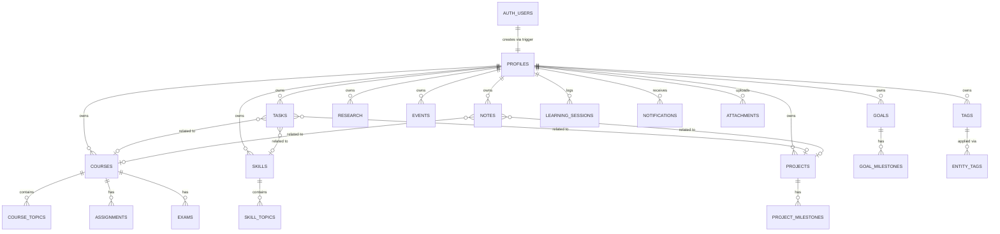

# DevOS — Complete Project Documentation

> **Personal Engineering & Academic Dashboard**
> A cross-platform mobile application built with Flutter, Supabase & PostgreSQL

---

## Table of Contents

1. [Project Overview](#1-project-overview)
2. [Problem Statement & Solution](#2-problem-statement--solution)
3. [Technology Stack](#3-technology-stack)
4. [System Architecture](#4-system-architecture)
5. [Project File & Directory Structure](#5-project-file--directory-structure)
6. [Backend — Supabase](#6-backend--supabase)
7. [Database Design — PostgreSQL](#7-database-design--postgresql)
8. [Entity Relationship Diagram](#8-entity-relationship-diagram)
9. [Row Level Security (RLS)](#9-row-level-security-rls)
10. [Storage — Supabase Buckets & Cloudflare R2](#10-storage--supabase-buckets--cloudflare-r2)
11. [Authentication System](#11-authentication-system)
12. [Frontend — Flutter UI Layer](#12-frontend--flutter-ui-layer)
13. [State Management — Riverpod](#13-state-management--riverpod)
14. [Data Models](#14-data-models)
15. [Repository Layer (Data Access)](#15-repository-layer-data-access)
16. [Feature Modules (Screens)](#16-feature-modules-screens)
17. [Navigation & App Shell](#17-navigation--app-shell)
18. [Theming & Design System](#18-theming--design-system)
19. [Reusable Widgets](#19-reusable-widgets)
20. [Seed Data & Initial Workspace](#20-seed-data--initial-workspace)
21. [SOLID Principles Applied](#21-solid-principles-applied)
22. [Data Flow — End to End](#22-data-flow--end-to-end)
23. [Security Summary](#23-security-summary)
24. [How to Run the Project](#24-how-to-run-the-project)
25. [Future Enhancements](#25-future-enhancements)

---

## 1. Project Overview

**DevOS** is a cross-platform mobile application designed to act as a **personal engineering and academic dashboard** for university students, developers, and technical learners.

Instead of using multiple disconnected apps to manage courses, assignments, learning progress, projects, research papers, notes, deadlines, and personal goals, DevOS brings all of these activities together into **one centralized platform**.

### Core Philosophy

```
Learn → Practice → Build → Research → Track Progress
```

| Attribute              | Value                                               |
|------------------------|-----------------------------------------------------|
| **Project Type**       | Cross-Platform Mobile Application                   |
| **Framework**          | Flutter (Dart)                                      |
| **Backend**            | Supabase (BaaS)                                     |
| **Database**           | PostgreSQL                                          |
| **Object Storage**     | Cloudflare R2 + Supabase Storage                    |
| **Authentication**     | Supabase Auth (email/password)                      |
| **State Management**   | Riverpod (StateNotifierProvider)                     |
| **Target Platforms**   | Android / iOS                                       |
| **Target Users**       | University students, CSE students, developers       |
| **Architecture**       | Feature-first, Repository Pattern, SOLID Principles |

---

## 2. Problem Statement & Solution

### Problems Faced by Students & Developers

- Academic information is scattered across different applications
- Assignment and project deadlines are easily forgotten
- Learning progress is difficult to measure
- Technical skills are learned without structured progression
- Project tasks and milestones are not properly organized
- Research papers and technical resources are hard to manage
- There is no single dashboard showing overall academic and technical progress

### DevOS Solution

DevOS provides a **centralized digital workspace** where users can manage:

- University courses, topics, assignments & exams
- Technical skills with sub-topic tracking
- Software development projects with milestones
- Tasks with priorities (low / medium / high / urgent) and statuses
- Long-term goals with milestones
- Notes organized as a personal knowledge base
- Research papers with metadata and status tracking
- Calendar events and deadlines
- Learning sessions and streak tracking
- Progress analytics and statistics

---

## 3. Technology Stack

| Layer                  | Technology                              | Purpose                                     |
|------------------------|-----------------------------------------|---------------------------------------------|
| **Mobile Frontend**    | Flutter 3.x                             | Cross-platform UI framework                 |
| **Language**           | Dart 3.13+                              | Application programming language            |
| **Backend Platform**   | Supabase                                | BaaS — auth, database, storage, API         |
| **Database**           | PostgreSQL                              | Relational database for structured data     |
| **Authentication**     | Supabase Auth                           | Email/password user authentication          |
| **Database Security**  | PostgreSQL RLS (Row Level Security)     | Per-user data isolation                     |
| **Object Storage**     | Supabase Storage / Cloudflare R2        | Avatar images, PDFs, attachments            |
| **State Management**   | flutter_riverpod ^2.5.1                 | Reactive state management                   |
| **Charts**             | fl_chart ^0.68.0                        | Analytics & data visualization              |
| **Calendar**           | table_calendar ^3.1.2                   | Calendar widget                             |
| **Typography**         | google_fonts ^6.2.1 (Inter, JetBrains) | Modern typography                           |
| **Animations**         | flutter_animate ^4.5.0                  | Micro-animations & transitions              |
| **Progress Bars**      | percent_indicator ^4.2.3                | Circular & linear progress indicators       |
| **Date Formatting**    | intl ^0.19.0                            | Localized date & time formatting            |
| **UUID Generation**    | uuid ^4.4.0                             | Client-side unique ID generation            |

---

## 4. System Architecture

### High-Level Architecture Diagram

```
┌─────────────────────────────────────────────────────────────┐
│                     FLUTTER APPLICATION                      │
│                                                              │
│   ┌──────────────┐   ┌──────────────┐   ┌───────────────┐   │
│   │   Features/   │   │   Widgets/   │   │   Providers/  │   │
│   │   Screens     │◄──│   Shared UI  │   │   Riverpod    │   │
│   └──────┬───────┘   └──────────────┘   └───────┬───────┘   │
│          │                                       │           │
│          │         ┌──────────────┐               │           │
│          └────────►│   Models/    │◄──────────────┘           │
│                    │   Data       │                           │
│                    └──────┬───────┘                           │
│                           │                                  │
│                    ┌──────┴───────┐                           │
│                    │ Repositories │  ◄── Interface Abstraction│
│                    │  (Data Layer)│                           │
│                    └──────┬───────┘                           │
│                           │                                  │
└───────────────────────────┼──────────────────────────────────┘
                            │
                   ┌────────┴────────┐
                   │  SUPABASE SDK   │
                   │ (supabase_flutter)│
                   └────────┬────────┘
                            │
              ┌─────────────┼─────────────┐
              │             │             │
   ┌──────────▼──┐  ┌──────▼─────┐  ┌────▼──────────┐
   │  Supabase   │  │ PostgreSQL │  │   Supabase    │
   │    Auth     │  │  Database  │  │   Storage     │
   │             │  │  (20 Tables)│  │  (Avatars)   │
   └─────────────┘  └────────────┘  └───────────────┘
                                           │
                                    ┌──────▼───────┐
                                    │ Cloudflare R2│
                                    │(PDFs, Files) │
                                    └──────────────┘
```

### Architecture Layers

| Layer               | Responsibility                                                    |
|---------------------|-------------------------------------------------------------------|
| **UI Layer**        | Flutter screens, widgets, modals — what the user sees and taps    |
| **Provider Layer**  | Riverpod StateNotifiers that hold & manage in-memory app state    |
| **Model Layer**     | Plain Dart classes representing domain entities (Course, Skill…)  |
| **Repository Layer**| Communicates with Supabase (DB queries, auth calls, storage ops)  |
| **Backend Layer**   | Supabase cloud — Auth service, PostgreSQL, Storage buckets        |

---

## 5. Project File & Directory Structure

```
devos/
│
├── lib/                              # Main application source code
│   │
│   ├── main.dart                     # App entry point, AuthWrapper, MainShell
│   │
│   ├── core/                         # Shared infrastructure
│   │   ├── constants/
│   │   │   ├── app_colors.dart       # Full color palette (dark + light)
│   │   │   └── supabase_config.dart  # Supabase URL & anon key
│   │   ├── models/
│   │   │   └── auth_result.dart      # AuthResult sealed-class (success/failure)
│   │   ├── theme/
│   │   │   └── app_theme.dart        # Dark & Light ThemeData (Material 3)
│   │   └── utils/
│   │       └── validators.dart       # Form validation (email, password, name)
│   │
│   ├── models/                       # Domain data models
│   │   ├── profile_model.dart        # UserProfile
│   │   ├── course_model.dart         # Course + CourseTopic
│   │   ├── skill_model.dart          # Skill + SkillTopic
│   │   ├── project_model.dart        # Project + ProjectMilestone
│   │   ├── task_model.dart           # DevTask + enums (Priority, Status)
│   │   ├── goal_model.dart           # Goal + GoalMilestone
│   │   ├── note_model.dart           # Note
│   │   ├── research_model.dart       # ResearchPaper
│   │   └── event_model.dart          # CalendarEvent
│   │
│   ├── repositories/                 # Data access layer
│   │   ├── interfaces/
│   │   │   ├── i_auth_repository.dart      # Auth interface (abstraction)
│   │   │   └── i_profile_repository.dart   # Profile interface
│   │   ├── supabase_auth_repository.dart   # Concrete Supabase Auth impl.
│   │   └── supabase_database_repository.dart # All CRUD ops for every table
│   │
│   ├── providers/                    # Riverpod state management
│   │   └── app_providers.dart        # All providers & StateNotifiers
│   │
│   ├── features/                     # Feature-based screen modules
│   │   ├── auth/
│   │   │   ├── login_screen.dart
│   │   │   └── sign_up_screen.dart
│   │   ├── dashboard/
│   │   │   └── dashboard_screen.dart
│   │   ├── courses/
│   │   │   ├── courses_screen.dart
│   │   │   ├── course_detail_screen.dart
│   │   │   └── add_edit_course_modal.dart
│   │   ├── skills/
│   │   │   ├── skills_screen.dart
│   │   │   └── add_edit_skill_modal.dart
│   │   ├── projects/
│   │   │   ├── projects_screen.dart
│   │   │   ├── project_detail_screen.dart
│   │   │   └── add_edit_project_modal.dart
│   │   ├── tasks/
│   │   │   ├── tasks_screen.dart
│   │   │   └── add_task_modal.dart
│   │   ├── goals/
│   │   │   ├── goals_screen.dart
│   │   │   └── add_edit_goal_modal.dart
│   │   ├── notes/
│   │   │   ├── notes_screen.dart
│   │   │   ├── note_detail_screen.dart
│   │   │   └── add_edit_note_modal.dart
│   │   ├── research/
│   │   │   ├── research_screen.dart
│   │   │   └── add_edit_research_modal.dart
│   │   ├── calendar/
│   │   │   ├── calendar_screen.dart
│   │   │   └── add_edit_event_modal.dart
│   │   ├── analytics/
│   │   │   └── analytics_screen.dart
│   │   └── search/
│   │       └── search_screen.dart
│   │
│   └── widgets/                      # Global reusable widgets
│       ├── badge_chip.dart
│       ├── section_header.dart
│       └── streak_badge.dart
│
├── supabase/
│   └── schema.sql                    # Complete PostgreSQL schema + RLS + Storage
│
├── pubspec.yaml                      # Flutter dependencies & project config
├── analysis_options.yaml             # Dart lint rules
└── README.md
```

---

## 6. Backend — Supabase

DevOS uses **Supabase** as a Backend-as-a-Service (BaaS) platform. Supabase provides:

| Service                  | How DevOS Uses It                                                  |
|--------------------------|--------------------------------------------------------------------|
| **Supabase Auth**        | Email/password registration, login, logout, session management     |
| **PostgreSQL Database**  | All structured application data (20 tables)                        |
| **Row Level Security**   | Per-user data isolation — users only see their own data            |
| **Auto-generated REST API** | Flutter queries tables via the Supabase Dart SDK              |
| **Storage Buckets**      | Avatar image uploads (public `avatars` bucket)                     |
| **Database Triggers**    | Automatically creates a `profiles` row when a new user signs up    |

### Supabase Connection

The app connects to Supabase via the `supabase_flutter` SDK, initialized in `main.dart`:

```dart
await Supabase.initialize(
  url: SupabaseConfig.supabaseUrl,
  anonKey: SupabaseConfig.supabaseAnonKey,
);
```

Configuration is stored in `lib/core/constants/supabase_config.dart`.

---

## 7. Database Design — PostgreSQL

The database consists of **20 tables** in the `public` schema. Every table uses **UUID primary keys** (via the `uuid-ossp` extension) and includes a `created_at` timestamp.

### Complete Table Reference

| # | Table Name            | Description                                          | Key Relationships                          |
|---|------------------------|------------------------------------------------------|--------------------------------------------|
| 1 | `profiles`             | User profile info (name, email, institution, streak) | PK = `auth.users.id` (1:1)                |
| 2 | `courses`              | University courses                                   | FK → `profiles.id` (many-to-one)          |
| 3 | `course_topics`        | Syllabus topics within a course                      | FK → `courses.id` (many-to-one)           |
| 4 | `assignments`          | Course assignments with due dates & grades           | FK → `courses.id`, FK → `profiles.id`     |
| 5 | `exams`                | Exam schedule with scores                            | FK → `courses.id`, FK → `profiles.id`     |
| 6 | `skills`               | Technical skills (Flutter, C++, Python…)              | FK → `profiles.id`                        |
| 7 | `skill_topics`         | Sub-topics within a skill                            | FK → `skills.id`                          |
| 8 | `projects`             | Software development projects                        | FK → `profiles.id`                        |
| 9 | `project_milestones`   | Milestones within a project                          | FK → `projects.id`                        |
| 10| `tasks`                | Tasks with priority & status                         | FK → `profiles.id`, optional FK → courses/projects/skills |
| 11| `goals`                | Long-term academic/career goals                      | FK → `profiles.id`                        |
| 12| `goal_milestones`      | Milestones within a goal                             | FK → `goals.id`                           |
| 13| `notes`                | Personal knowledge base notes                        | FK → `profiles.id`, optional FK → courses/projects |
| 14| `research`             | Research paper metadata                              | FK → `profiles.id`                        |
| 15| `tags`                 | User-defined tags with color                         | FK → `profiles.id`, UNIQUE(user_id, name) |
| 16| `entity_tags`          | Polymorphic junction table linking tags to entities   | FK → `tags.id`, `entity_type` + `entity_id` |
| 17| `events`               | Calendar events (exams, deadlines, sessions)         | FK → `profiles.id`                        |
| 18| `learning_sessions`    | Study session logs (topic, duration, date)           | FK → `profiles.id`                        |
| 19| `notifications`        | In-app notification messages                         | FK → `profiles.id`                        |
| 20| `attachments`          | File metadata referencing Cloudflare R2 objects      | FK → `profiles.id`, `entity_type` + `entity_id` |

### Key Column Patterns

- **Status columns** use `CHECK` constraints with explicit allowed values:
  - `assignments.status`: `pending`, `in_progress`, `submitted`, `graded`
  - `projects.status`: `planning`, `in_progress`, `completed`, `on_hold`
  - `tasks.status`: `pending`, `in_progress`, `completed`
  - `tasks.priority`: `low`, `medium`, `high`, `urgent`
  - `goals.status`: `active`, `achieved`, `paused`
  - `research.status`: `saved`, `reading`, `completed`, `important`
  - `events.event_type`: `exam`, `assignment`, `project_deadline`, `learning_session`, `general`

- **Progress tracking**: `progress_percentage INTEGER DEFAULT 0` on courses, skills, projects, and goals

- **Technologies** stored as PostgreSQL arrays: `technologies TEXT[]` on projects

- **Cascade deletes**: All child tables use `ON DELETE CASCADE` — deleting a course automatically deletes its topics, assignments, and exams

---

## 8. Entity Relationship Diagram



### Relationship Summary

```
USER (profiles)
 │
 ├── Courses
 │     ├── Course Topics        (checkbox-style syllabus tracking)
 │     ├── Assignments          (due dates, grades, status)
 │     └── Exams                (exam dates, scores)
 │
 ├── Skills
 │     └── Skill Topics         (checkbox-style learning tracking)
 │
 ├── Projects
 │     └── Project Milestones   (milestone tracking with dates)
 │
 ├── Tasks                      (cross-module tasks with priority)
 │     ├──► related to Course?
 │     ├──► related to Project?
 │     └──► related to Skill?
 │
 ├── Goals
 │     └── Goal Milestones      (milestone tracking)
 │
 ├── Notes                      (knowledge base, favorites)
 │     ├──► related to Course?
 │     └──► related to Project?
 │
 ├── Research Papers            (paper metadata, status tracking)
 │     └── Attachments (R2)     (PDF files stored externally)
 │
 ├── Events                     (calendar events & deadlines)
 ├── Learning Sessions          (study time logs)
 ├── Tags                       (user-defined, color-coded)
 │     └── Entity Tags          (polymorphic links to any entity)
 ├── Notifications              (in-app messages)
 └── Attachments                (file metadata → Cloudflare R2)
```

---

## 9. Row Level Security (RLS)

**Every table** in the database has Row Level Security (RLS) enabled. This ensures that:

- A user can **only read, insert, update, and delete their own records**
- Even if someone bypasses the Flutter client, the database itself enforces isolation

### RLS Policy Pattern

For direct user-owned tables:
```sql
CREATE POLICY "Users can manage their courses"
  ON public.courses FOR ALL
  USING (auth.uid() = user_id);
```

For child tables (no direct `user_id`), RLS checks the parent:
```sql
CREATE POLICY "Users can manage course topics"
  ON public.course_topics FOR ALL
  USING (
    course_id IN (SELECT id FROM public.courses WHERE user_id = auth.uid())
  );
```

### Tables with RLS Enabled

All 20 tables: `profiles`, `courses`, `course_topics`, `assignments`, `exams`, `skills`, `skill_topics`, `projects`, `project_milestones`, `tasks`, `goals`, `goal_milestones`, `notes`, `research`, `tags`, `entity_tags`, `events`, `learning_sessions`, `notifications`, `attachments`

---

## 10. Storage — Supabase Buckets & Cloudflare R2

### Supabase Storage (Avatars)

A **public** `avatars` bucket is configured in the schema:

```sql
INSERT INTO storage.buckets (id, name, public)
VALUES ('avatars', 'avatars', true);
```

Storage RLS policies ensure:
- Anyone can **view** avatar images (public bucket)
- Users can only **upload/update/delete** their own avatar (folder = `<user_id>/`)

### Cloudflare R2 (Large Files)

For larger files (PDFs, research papers, project attachments), the architecture separates storage:

| Storage Type        | What It Stores                     | How It's Referenced              |
|---------------------|------------------------------------|----------------------------------|
| **PostgreSQL**      | File metadata (name, type, size)   | `attachments` table              |
| **Cloudflare R2**   | Actual binary file                 | `r2_object_key` column           |

```
PostgreSQL: attachments.r2_object_key = "research/105/paper.pdf"
R2 Bucket:  research/105/paper.pdf → actual PDF file
```

---

## 11. Authentication System

### Flow Diagram

```
┌──────────┐      ┌──────────────────┐      ┌──────────────┐
│  Login   │─────►│ SupabaseAuth     │─────►│ Supabase     │
│  Screen  │      │ Repository       │      │ Auth Service │
└──────────┘      └──────────────────┘      └──────┬───────┘
                                                    │
                                            ┌───────▼───────┐
                                            │ DB Trigger:   │
                                            │ Creates       │
                                            │ profiles row  │
                                            └───────────────┘
```

### Authentication Components

| Component                      | File                                              | Role                                         |
|--------------------------------|---------------------------------------------------|----------------------------------------------|
| **IAuthRepository** (interface)| `repositories/interfaces/i_auth_repository.dart`  | Abstract contract — Dependency Inversion     |
| **SupabaseAuthRepository**     | `repositories/supabase_auth_repository.dart`      | Concrete Supabase implementation             |
| **AuthResult**                 | `core/models/auth_result.dart`                    | Success/failure result type                  |
| **FormValidators**             | `core/utils/validators.dart`                      | Email, password, name validation logic       |
| **LoginScreen**                | `features/auth/login_screen.dart`                 | Login UI                                     |
| **SignUpScreen**               | `features/auth/sign_up_screen.dart`               | Registration UI with academic details        |
| **AuthWrapper**                | `main.dart`                                       | Listens to auth state, routes Login or Shell  |

### Auth Operations

| Operation       | Method Signature                                                  |
|-----------------|-------------------------------------------------------------------|
| **Sign In**     | `signIn({email, password}) → Future<AuthResult>`                  |
| **Sign Up**     | `signUp({email, password, fullName, institution, major, academicYear}) → Future<AuthResult>` |
| **Sign Out**    | `signOut() → Future<void>`                                        |
| **Current User**| `getCurrentUser() → UserProfile?`                                 |

### Database Trigger — Automatic Profile Creation

When a new user registers, a PostgreSQL trigger automatically inserts a row into `profiles`:

```sql
CREATE TRIGGER on_auth_user_created
  AFTER INSERT ON auth.users
  FOR EACH ROW EXECUTE FUNCTION public.handle_new_user();
```

The trigger extracts `full_name` and `avatar_url` from `raw_user_meta_data` and creates the profile.

---

## 12. Frontend — Flutter UI Layer

### App Entry Point (`main.dart`)

```
main()
  └── Supabase.initialize()
  └── ProviderScope (Riverpod)
       └── DevOSApp (MaterialApp)
            ├── theme: AppTheme.lightTheme
            ├── darkTheme: AppTheme.darkTheme
            └── home: AuthWrapper
                 ├── NOT authenticated → LoginScreen
                 └── Authenticated → DevOSMainShell
                      ├── AppBar (title, search, theme toggle)
                      ├── Drawer (all 10 navigation items + logout)
                      ├── Body (10 pages switched by index)
                      └── BottomNavigationBar (5 primary tabs)
```

### Screen Architecture

Each feature module follows a consistent pattern:

```
feature/
├── <feature>_screen.dart           # Main list/grid screen
├── <feature>_detail_screen.dart    # Detail view (when applicable)
└── add_edit_<feature>_modal.dart   # Bottom sheet modal for CRUD forms
```

---

## 13. State Management — Riverpod

DevOS uses **flutter_riverpod** with the `StateNotifierProvider` pattern. All providers are defined in a single file: `lib/providers/app_providers.dart`.

### Provider Architecture

```
┌─────────────────────────────────────────┐
│            Riverpod Providers            │
│                                          │
│  ┌─────────────────────────────────┐     │
│  │ databaseRepositoryProvider      │──┐  │
│  │ (SupabaseDatabaseRepository)    │  │  │
│  └─────────────────────────────────┘  │  │
│                                       │  │
│  ┌─────────────────────────────────┐  │  │
│  │ authRepositoryProvider          │  │  │
│  │ (IAuthRepository)              │  │  │
│  └─────────────────────────────────┘  │  │
│                                       │  │
│  ┌─────────────────────────────────┐  │  │
│  │ themeModeProvider               │  │  │
│  │ (ThemeModeNotifier → ThemeMode) │  │  │
│  └─────────────────────────────────┘  │  │
│                                       │  │
│  All Data Notifiers (depend on DB):   │  │
│  │ profileProvider     ◄──────────────┘  │
│  │ coursesProvider     ◄──────────────┘  │
│  │ skillsProvider      ◄──────────────┘  │
│  │ projectsProvider    ◄──────────────┘  │
│  │ tasksProvider       ◄──────────────┘  │
│  │ goalsProvider       ◄──────────────┘  │
│  │ notesProvider       ◄──────────────┘  │
│  │ researchProvider    ◄──────────────┘  │
│  │ eventsProvider      ◄──────────────┘  │
│  │                                       │
│  ┌─────────────────────────────────┐     │
│  │ searchQueryProvider             │     │
│  │ syncWorkspaceProvider           │     │
│  └─────────────────────────────────┘     │
└──────────────────────────────────────────┘
```

### Complete Provider Reference

| Provider                   | Type                                            | Purpose                                         |
|----------------------------|-------------------------------------------------|-------------------------------------------------|
| `authRepositoryProvider`   | `Provider<IAuthRepository>`                     | Auth operations (DIP — abstraction)             |
| `databaseRepositoryProvider`| `Provider<SupabaseDatabaseRepository>`          | All database CRUD operations                    |
| `themeModeProvider`        | `StateNotifierProvider<ThemeModeNotifier, ThemeMode>` | Dark/light theme toggle                    |
| `profileProvider`          | `StateNotifierProvider<ProfileNotifier, UserProfile>` | Current user profile                       |
| `coursesProvider`          | `StateNotifierProvider<CoursesNotifier, List<Course>>` | All user courses + topics                 |
| `skillsProvider`           | `StateNotifierProvider<SkillsNotifier, List<Skill>>`  | All user skills + topics                  |
| `projectsProvider`         | `StateNotifierProvider<ProjectsNotifier, List<Project>>` | All user projects + milestones         |
| `tasksProvider`            | `StateNotifierProvider<TasksNotifier, List<DevTask>>`  | All user tasks                           |
| `goalsProvider`            | `StateNotifierProvider<GoalsNotifier, List<Goal>>`     | All user goals + milestones              |
| `notesProvider`            | `StateNotifierProvider<NotesNotifier, List<Note>>`     | All user notes                           |
| `researchProvider`         | `StateNotifierProvider<ResearchNotifier, List<ResearchPaper>>` | All research papers             |
| `eventsProvider`           | `StateNotifierProvider<EventsNotifier, List<CalendarEvent>>` | All calendar events               |
| `searchQueryProvider`      | `StateProvider<String>`                         | Global search query string                      |
| `syncWorkspaceProvider`    | `FutureProvider<void>`                          | Seeds data & loads all providers on login        |

### StateNotifier Pattern

Each notifier follows the same pattern:

```dart
class CoursesNotifier extends StateNotifier<List<Course>> {
  final SupabaseDatabaseRepository _db;

  CoursesNotifier(this._db) : super([]) {
    loadCourses();  // Auto-load on creation
  }

  Future<void> loadCourses() async { ... }
  Future<void> addCourse(Course course) async { ... }
  Future<void> updateCourse(Course updated) async { ... }
  Future<void> deleteCourse(String courseId) async { ... }
  Future<void> toggleTopic(String courseId, String topicId) async { ... }
}
```

### Progress Auto-Calculation

When topics/milestones are toggled, progress is **automatically recalculated**:

```dart
final completedCount = updatedTopics.where((t) => t.isCompleted).length;
final newPercentage = updatedTopics.isEmpty
    ? 0
    : ((completedCount / updatedTopics.length) * 100).round();
```

---

## 14. Data Models

All models are in `lib/models/` and follow a consistent pattern:

- Constructor with named required/optional parameters
- `factory fromJson(Map<String, dynamic>)` — parses Supabase JSON responses
- `Map<String, dynamic> toJson()` — serializes for Supabase inserts/updates
- `copyWith(...)` — immutable state updates for Riverpod

### Model Reference

| Model              | File                      | Key Fields                                                   |
|--------------------|---------------------------|--------------------------------------------------------------|
| **UserProfile**    | `profile_model.dart`      | id, email, fullName, avatarUrl, institution, major, academicYear, learningStreak |
| **Course**         | `course_model.dart`       | id, name, code, instructor, creditHours, description, colorHex, progressPercentage, `List<CourseTopic>` |
| **CourseTopic**    | `course_model.dart`       | id, title, isCompleted, orderIndex                            |
| **Skill**          | `skill_model.dart`        | id, name, category, proficiencyLevel, progressPercentage, `List<SkillTopic>` |
| **SkillTopic**     | `skill_model.dart`        | id, title, isCompleted, orderIndex                            |
| **Project**        | `project_model.dart`      | id, title, description, technologies[], githubUrl, liveUrl, startDate, targetCompletionDate, status, progressPercentage, `List<ProjectMilestone>` |
| **ProjectMilestone** | `project_model.dart`    | id, title, targetDate, isCompleted, orderIndex                |
| **DevTask**        | `task_model.dart`         | id, title, description, category, priority (enum), status (enum), dueDate |
| **Goal**           | `goal_model.dart`         | id, title, description, category, targetDate, progressPercentage, status, `List<GoalMilestone>` |
| **GoalMilestone**  | `goal_model.dart`         | id, title, isCompleted, orderIndex                            |
| **Note**           | `note_model.dart`         | id, title, content, category, isFavorite, createdAt, updatedAt |
| **ResearchPaper**  | `research_model.dart`     | id, title, authors, publicationYear, topic, paperLink, personalNotes, keyFindings, status |
| **CalendarEvent**  | `event_model.dart`        | id, title, description, eventType, startTime, endTime         |
| **AuthResult**     | `auth_result.dart`        | isSuccess, user?, errorMessage?, requiresEmailConfirmation    |

### Enums

```dart
enum TaskPriority { low, medium, high, urgent }
enum TaskStatus { pending, inProgress, completed }
```

---

## 15. Repository Layer (Data Access)

### Interface Abstraction (Dependency Inversion)

```dart
/// Contract for authentication operations
abstract class IAuthRepository {
  Future<AuthResult> signIn({required String email, required String password});
  Future<AuthResult> signUp({...});
  Future<void> signOut();
  UserProfile? getCurrentUser();
}
```

The app depends on `IAuthRepository` (abstraction), not `SupabaseAuthRepository` (concrete). This allows swapping backends without changing the UI or provider layer.

### SupabaseDatabaseRepository

This is the **central data access class** (`supabase_database_repository.dart`, ~843 lines). It provides full CRUD operations for all entities:

| Entity      | Methods                                                                  |
|-------------|--------------------------------------------------------------------------|
| **Profile** | `getProfile()`, `updateProfile()`                                        |
| **Courses** | `getCourses()`, `addCourse()`, `updateCourse()`, `deleteCourse()`, `toggleCourseTopic()` |
| **Skills**  | `getSkills()`, `addSkill()`, `updateSkill()`, `deleteSkill()`, `toggleSkillTopic()` |
| **Projects**| `getProjects()`, `addProject()`, `updateProject()`, `deleteProject()`, `toggleProjectMilestone()` |
| **Tasks**   | `getTasks()`, `addTask()`, `updateTask()`, `deleteTask()`                |
| **Goals**   | `getGoals()`, `addGoal()`, `updateGoal()`, `deleteGoal()`, `toggleGoalMilestone()` |
| **Notes**   | `getNotes()`, `addNote()`, `updateNote()`, `deleteNote()`                |
| **Research**| `getResearchPapers()`, `addResearchPaper()`, `updateResearchPaper()`, `deleteResearchPaper()` |
| **Events**  | `getEvents()`, `addEvent()`, `updateEvent()`, `deleteEvent()`            |
| **Seeder**  | `seedInitialWorkspaceDataIfEmpty()` — populates demo data on first login |

### Query Patterns

**Parent + Children** (single query with embedded join):
```dart
final response = await _client
    .from('courses')
    .select('*, course_topics(*)')     // Supabase auto-join
    .eq('user_id', userId)
    .order('created_at', ascending: false);
```

**User-scoped mutations** (always filter by `user_id`):
```dart
await _client.from('courses').delete()
    .eq('id', courseId)
    .eq('user_id', userId);   // Defense-in-depth alongside RLS
```

---

## 16. Feature Modules (Screens)

### 16.1 Authentication (`features/auth/`)

| Screen          | File                  | Features                                                     |
|-----------------|-----------------------|--------------------------------------------------------------|
| **Login**       | `login_screen.dart`   | Email/password login, validation, error handling, link to signup |
| **Sign Up**     | `sign_up_screen.dart` | Full registration with academic details (name, institution, major, year) |

### 16.2 Dashboard (`features/dashboard/`)

The dashboard is the **main home screen** providing an overview:
- Today's tasks (pending/completed counts)
- Upcoming deadlines
- Active projects summary
- Learning progress indicators
- Current goals status
- Learning streak display
- Quick navigation to all modules

### 16.3 Course Management (`features/courses/`)

| Screen           | Description                                              |
|------------------|----------------------------------------------------------|
| **CoursesList**   | Grid/list of all courses with progress bars              |
| **CourseDetail**  | Detailed view: topics checklist, assignments, exams      |
| **AddEditModal**  | Create/edit course with topics                           |

### 16.4 Skill Tracking (`features/skills/`)

| Screen           | Description                                              |
|------------------|----------------------------------------------------------|
| **SkillsList**    | All technical skills with proficiency & progress         |
| **AddEditModal**  | Create/edit skill with sub-topics                        |

Progress auto-calculates from completed sub-topics.

### 16.5 Project Management (`features/projects/`)

| Screen           | Description                                              |
|------------------|----------------------------------------------------------|
| **ProjectsList**  | All projects with status badges & progress               |
| **ProjectDetail** | Milestones checklist, tech stack, GitHub/live URLs        |
| **AddEditModal**  | Create/edit project with milestones & technologies       |

### 16.6 Task Management (`features/tasks/`)

| Screen           | Description                                              |
|------------------|----------------------------------------------------------|
| **TasksList**     | Filterable task list with priority color coding           |
| **AddTaskModal**  | Create task with category, priority, due date             |

Priority levels: `Low` (green) → `Medium` (blue) → `High` (amber) → `Urgent` (red)

### 16.7 Goal Management (`features/goals/`)

| Screen           | Description                                              |
|------------------|----------------------------------------------------------|
| **GoalsList**     | All goals with progress & milestone counts               |
| **AddEditModal**  | Create/edit goal with milestones & target dates           |

### 16.8 Notes & Knowledge Base (`features/notes/`)

| Screen           | Description                                              |
|------------------|----------------------------------------------------------|
| **NotesList**     | All notes, filterable by category, favorites              |
| **NoteDetail**    | Full note content view                                   |
| **AddEditModal**  | Create/edit note with category & content                  |

### 16.9 Research Management (`features/research/`)

| Screen           | Description                                              |
|------------------|----------------------------------------------------------|
| **ResearchList**  | All research papers with status badges                   |
| **AddEditModal**  | Create/edit paper metadata, links, notes, findings       |

### 16.10 Calendar & Deadlines (`features/calendar/`)

| Screen           | Description                                              |
|------------------|----------------------------------------------------------|
| **CalendarView**  | Monthly calendar with event markers (table_calendar)     |
| **AddEditModal**  | Create/edit events with type, time range                  |

Event types: `exam`, `assignment`, `project_deadline`, `learning_session`, `general`

### 16.11 Analytics & Progress (`features/analytics/`)

| Screen           | Description                                              |
|------------------|----------------------------------------------------------|
| **AnalyticsView** | Charts & statistics using fl_chart                       |

Metrics include: course progress, skill distribution, project completion rates, task completion stats, goal tracking.

### 16.12 Global Search (`features/search/`)

| Screen           | Description                                              |
|------------------|----------------------------------------------------------|
| **SearchScreen**  | Cross-module search across courses, skills, projects, tasks, notes, research |

---

## 17. Navigation & App Shell

### DevOSMainShell

The main app shell provides two navigation mechanisms:

#### Bottom Navigation Bar (5 primary tabs)

| Index | Tab        | Screen           |
|-------|------------|------------------|
| 0     | Dashboard  | DashboardScreen  |
| 1     | Courses    | CoursesScreen    |
| 2     | Skills     | SkillsScreen     |
| 3     | Projects   | ProjectsScreen   |
| 4     | Tasks      | TasksScreen      |

#### Navigation Drawer (all 10 modules + actions)

| Index | Item                    | Screen            |
|-------|-------------------------|-------------------|
| 0     | Dashboard Overview      | DashboardScreen   |
| 1     | Courses & Syllabus      | CoursesScreen     |
| 2     | Skill Matrix            | SkillsScreen      |
| 3     | Software Projects       | ProjectsScreen    |
| 4     | Task Management         | TasksScreen       |
| 5     | Goals & Roadmaps        | GoalsScreen       |
| 6     | Notes & Knowledge Base  | NotesScreen       |
| 7     | Research Papers         | ResearchScreen    |
| 8     | Calendar & Deadlines    | CalendarScreen    |
| 9     | Analytics & Stats       | AnalyticsScreen   |
| —     | Create New Account      | SignUpScreen      |
| —     | Logout / Switch User    | Signs out         |

#### AppBar Actions

- **Search** icon → navigates to `SearchScreen`
- **Theme Toggle** icon → switches between dark/light mode

---

## 18. Theming & Design System

### Dual Theme Support

DevOS supports both **Dark Mode** (default) and **Light Mode**, toggled at runtime via `ThemeModeNotifier`.

### Color Palette

| Color Name        | Hex Code    | Usage                                  |
|-------------------|-------------|----------------------------------------|
| **Primary**       | `#06B6D4`   | Cyan — primary accent, active states   |
| **Secondary**     | `#10B981`   | Emerald — success, secondary accent    |
| **Accent Violet** | `#8B5CF6`   | Purple — tags, categories              |
| **Accent Amber**  | `#F59E0B`   | Amber — warnings, high priority        |
| **Accent Rose**   | `#EF4444`   | Red — errors, urgent, destructive      |
| **Accent Blue**   | `#3B82F6`   | Blue — info, medium priority           |

#### Dark Theme Colors

| Token                  | Hex         | Usage                    |
|------------------------|-------------|--------------------------|
| `backgroundDark`       | `#0B0F17`   | Scaffold background      |
| `surfaceDark`          | `#131B29`   | Drawer, nav bar          |
| `cardDark`             | `#1B2436`   | Card backgrounds         |
| `cardBorderDark`       | `#28364F`   | Card borders             |
| `textPrimaryDark`      | `#F1F5F9`   | Primary text             |
| `textSecondaryDark`    | `#94A3B8`   | Secondary text           |
| `textMutedDark`        | `#64748B`   | Muted/placeholder text   |

#### Light Theme Colors

| Token                  | Hex         | Usage                    |
|------------------------|-------------|--------------------------|
| `backgroundLight`      | `#F8FAFC`   | Scaffold background      |
| `surfaceLight`         | `#FFFFFF`   | Drawer, nav bar          |
| `cardLight`            | `#FFFFFF`   | Card backgrounds         |
| `cardBorderLight`      | `#E2E8F0`   | Card borders             |
| `textPrimaryLight`     | `#0F172A`   | Primary text             |
| `textSecondaryLight`   | `#475569`   | Secondary text           |
| `textMutedLight`       | `#94A3B8`   | Muted/placeholder text   |

### Typography

| Font           | Package          | Usage                              |
|----------------|------------------|------------------------------------|
| **Inter**      | google_fonts     | Primary UI font (all text styles)  |
| **JetBrains Mono** | google_fonts | Monospace labels (code-like text)  |

### Material 3

The app uses `useMaterial3: true` with customized `CardTheme`, `AppBarTheme`, `FloatingActionButtonTheme`, and `BottomNavigationBarTheme`.

---

## 19. Reusable Widgets

Located in `lib/widgets/`:

| Widget              | File                  | Purpose                                |
|---------------------|-----------------------|----------------------------------------|
| **BadgeChip**       | `badge_chip.dart`     | Colored status/category badge          |
| **SectionHeader**   | `section_header.dart` | Section title with optional action     |
| **StreakBadge**      | `streak_badge.dart`   | Learning streak display (fire 12 days) |

---

## 20. Seed Data & Initial Workspace

On **first login**, the `syncWorkspaceProvider` triggers `seedInitialWorkspaceDataIfEmpty()`, which populates the database with demo data so the dashboard is not empty:

| Entity          | Seeded Items                                                        |
|-----------------|---------------------------------------------------------------------|
| **Courses**     | Data Structures & Algorithms, Distributed Systems & Cloud Computing |
| **Skills**      | Flutter & Dart Architecture                                         |
| **Projects**    | DevOS Engineering Workspace                                         |
| **Tasks**       | 3 tasks (DSA assignment, RLS deployment, Raft review)               |
| **Goals**       | Master Distributed Systems & Cloud Infrastructure                   |
| **Notes**       | Supabase RLS Best Practices, SOLID Principles in Flutter            |
| **Research**    | Raft Consensus Algorithm paper                                      |
| **Events**      | Algorithms Midterm Exam, DevOS Milestone 2 Code Review              |

The seeder checks if any courses exist first — if data already exists, seeding is skipped.

---

## 21. SOLID Principles Applied

| Principle                      | Implementation in DevOS                                              |
|--------------------------------|----------------------------------------------------------------------|
| **Single Responsibility (SRP)**| Each class has one job: models hold data, repositories handle DB ops, notifiers manage state, screens render UI |
| **Open/Closed (OCP)**          | New features can be added as new feature modules without modifying existing ones |
| **Liskov Substitution (LSP)**  | `SupabaseAuthRepository` can be replaced by any `IAuthRepository` implementation |
| **Interface Segregation (ISP)**| Separate `IAuthRepository` and `IProfileRepository` interfaces       |
| **Dependency Inversion (DIP)** | Providers depend on `IAuthRepository` (abstraction), not `SupabaseAuthRepository` (concrete) |

---

## 22. Data Flow — End to End

### Example: User Creates a New Course

```
1. User taps FAB (+) on CoursesScreen
2. AddEditCourseModal opens as a bottom sheet
3. User fills in: name, code, instructor, credit hours, topics
4. User taps "Save"
5. Modal calls: ref.read(coursesProvider.notifier).addCourse(course)
6. CoursesNotifier.addCourse() calls:
   └── _db.addCourse(course)
       └── INSERT INTO courses (...) → Supabase REST API → PostgreSQL
       └── INSERT INTO course_topics (...) → Supabase REST API → PostgreSQL
       └── Returns Course.fromJson(response)
7. CoursesNotifier updates state: state = [created, ...state]
8. Riverpod notifies all listeners
9. CoursesScreen rebuilds with the new course card
```

### Example: Authentication Flow

```
1. User enters email & password on LoginScreen
2. LoginScreen calls: ref.read(authRepositoryProvider).signIn(email, password)
3. SupabaseAuthRepository.signIn():
   └── Supabase.auth.signInWithPassword(email, password)
   └── Fetches profile from profiles table
   └── Returns AuthResult.success(UserProfile)
4. LoginScreen receives success → calls onLoginSuccess callback
5. AuthWrapper.setState(() => _isAuthenticated = true)
6. AuthWrapper rebuilds → shows DevOSMainShell instead of LoginScreen
7. syncWorkspaceProvider triggers → loads all data into providers
```

---

## 23. Security Summary

| Security Layer           | Implementation                                                     |
|--------------------------|--------------------------------------------------------------------|
| **Authentication**       | Supabase Auth — email/password with JWT tokens                     |
| **Authorization (RLS)**  | PostgreSQL Row Level Security on all 20 tables                     |
| **User Isolation**       | `auth.uid() = user_id` policy on every table                       |
| **Child Table Security** | RLS checks parent ownership (e.g., course_topics → courses.user_id)|
| **Input Validation**     | Client-side validators for email, password, names                  |
| **Defense in Depth**     | Repository methods also filter by `user_id` alongside RLS          |
| **Storage Security**     | Storage RLS policies restrict upload/delete to file owner           |
| **No Embedded Secrets**  | R2 credentials handled server-side (not in Flutter client)         |

---

## 24. How to Run the Project

### Prerequisites

- Flutter SDK 3.x+ (Dart SDK ^3.13.0)
- Android Studio or VS Code with Flutter extension
- A Supabase project (or use the existing configured one)
- An Android device/emulator or iOS simulator

### Steps

```bash
# 1. Clone the repository
git clone <repository-url>
cd devos

# 2. Install dependencies
flutter pub get

# 3. (Optional) Update Supabase credentials
#    Edit: lib/core/constants/supabase_config.dart

# 4. Set up the database
#    Run supabase/schema.sql in your Supabase SQL Editor

# 5. Run the app
flutter run
```

### Build for Release

```bash
# Android APK
flutter build apk --release

# Android App Bundle
flutter build appbundle --release

# iOS (requires macOS)
flutter build ios --release
```

---

## 25. Future Enhancements

| Enhancement                         | Description                                      |
|-------------------------------------|--------------------------------------------------|
| AI-powered study assistant          | Intelligent study plan generation                |
| GitHub integration                  | Auto-track project commits & activity            |
| Spaced-repetition revision          | Smart review scheduling                          |
| PDF content search                  | Search within uploaded research papers           |
| Portfolio generation                | Auto-generate developer portfolio                |
| Team collaboration                  | Shared projects & study groups                   |
| Offline synchronization             | Work offline, sync when connected                |
| Push notifications                  | Native reminders for deadlines & events          |
| Web & desktop apps                  | Flutter web and desktop targets                  |
| Advanced analytics with AI insights | ML-powered progress predictions                  |

---

> **DevOS** — *Learn → Practice → Build → Research → Measure → Improve*
